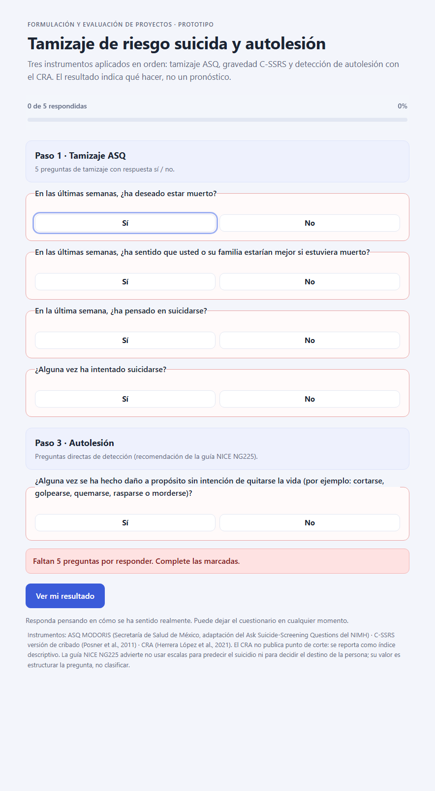
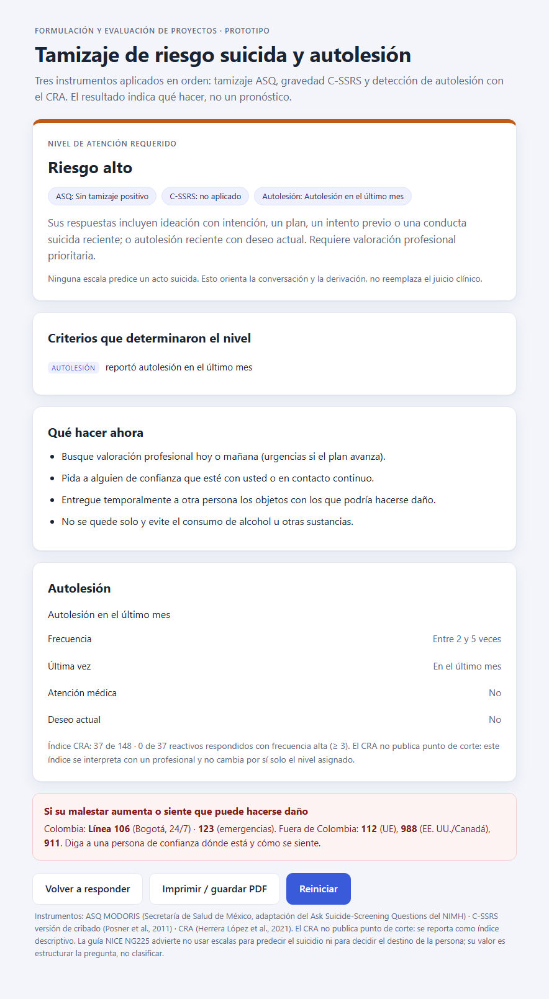

# Tamizaje de riesgo suicida y autolesión (prototipo)

Formulario web aplicado en orden, con instrumentos reales y sus reglas publicadas: **ASQ** (tamizaje de riesgo suicida), **C-SSRS versión de cribado** (gravedad de ideación y conducta) y **CRA** (Cuestionario de Riesgo de Autolesión, validado en Colombia). Al final entrega un **nivel de atención requerido** y qué hacer.

> ⚠️ Es un tamizaje: no diagnostica, no predice lo que va a pasar y no sustituye la valoración de un profesional. La guía NICE NG225 advierte expresamente no usar escalas para predecir el suicidio ni para decidir a quién se trata o se da de alta.

## Cómo usarlo

Abrir `index.html` con doble clic (sin servidor ni instalación; el cálculo ocurre en el navegador y las respuestas no se guardan ni se envían). Alternativa: `npx serve .` o `python -m http.server`.



## Flujo adaptativo

| Paso | Instrumento | Cuándo se aplica | Qué produce |
| --- | --- | --- | --- |
| 1 | **ASQ** (5 preguntas sí/no) | Siempre | Tamizaje positivo / negativo y orden de riesgo (1 a 4) |
| 2 | **C-SSRS versión de cribado** (5 de ideación + conducta) | Solo si el ASQ es positivo | Nivel: bajo / moderado / alto |
| 3 | **Autolesión** (indagación directa, NICE NG225) | Siempre | Sin reporte / pasada / últimos 12 meses / último mes; deseo actual |
| 3b | **CRA** (37 reactivos, escala 0–4) | Solo si se reporta autolesión | Índice descriptivo 0–148 y reactivos con frecuencia alta |

**Nivel de atención requerido** = el más alto entre el nivel suicida (ASQ ∪ C-SSRS) y el nivel de autolesión. Se muestran los criterios exactos que lo determinaron, con la etiqueta del instrumento de origen.

### Reglas aplicadas (publicadas, no inventadas)

**ASQ / MODORIS** (cualquier "sí" en las preguntas 1–4 = tamizaje positivo y obliga al C-SSRS):

| Respuesta | Orden de riesgo |
| --- | --- |
| Sí a "¿está pensando en suicidarse en este momento?" (p5) | Inminente (4) |
| Sí a "¿alguna vez ha intentado suicidarse?" (p4) | Alto (3) |
| Sí a "¿ha pensado en suicidarse en la última semana?" (p3) | Moderado (2) |
| Sí a deseo de estar muerto o "estarían mejor si estuviera muerto" (p1–p2) | Bajo (1) |
| Todo no | Sin señales |

**C-SSRS, versión de cribado** (Posner et al., 2011):

| Respuesta | Nivel |
| --- | --- |
| Sí a intención (p4), plan (p5) o conducta suicida en los últimos 3 meses | Alto |
| Sí a método pensado (p3) o conducta de hace más de 3 meses | Moderado |
| Sí a deseo de muerte (p1) o pensamientos de matarse (p2) | Bajo |
| Todo no | Sin señales |

**Autolesión** (indagación directa, recomendación de NICE NG225): último mes → nivel alto; 12 meses → moderado; hace más de un año → bajo; **deseo o necesidad actual de hacerse daño → nivel alto** aunque la conducta sea antigua.

**CRA**: se reporta el índice total (0–148) y cuántos reactivos se respondieron con frecuencia alta (≥ 3). **No se aplica punto de corte porque la validación colombiana no publica uno**; el índice se interpreta con un profesional y no modifica por sí solo el nivel asignado.



## Estado científico de cada pieza

| Pieza | Origen exacto | Nivel de respaldo |
| --- | --- | --- |
| ASQ | **MODORIS**, Secretaría de Salud de México (Programa Nacional para la Prevención del Suicidio); adaptación del *Ask Suicide-Screening Questions* del NIMH. Texto transcrito del PDF oficial | Instrumento del NIMH con validación publicada; la adaptación mexicana define los 4 órdenes de riesgo usados aquí |
| C-SSRS | Versión de cribado de la *Columbia-Suicide Severity Rating Scale* (Posner et al., 2011) | Instrumento validado multicéntrico; el triage bajo/moderado/alto es el de la versión de cribado |
| Preguntas de autolesión | Indagación directa recomendada por **NICE NG225** | Recomendación de guía de práctica clínica; no es una escala psicométrica |
| CRA | Herrera López et al. (2021), *Revista Boletín REDIPE* 10(13), 252–271. 37 ítems, α = .96, n = 289 adolescentes colombianos | Instrumento validado en Colombia; **sin punto de corte publicado** |

Advertencias de traducción y permisos:
- El ASQ está transcrito de la adaptación oficial al español de la Secretaría de Salud de México.
- El C-SSRS se transcribió en español a partir de la versión de cribado difundida por el Columbia Lighthouse Project; conviene contrastar la redacción con su traducción oficial vigente antes de un uso operativo.
- El CRA se reproduce con fines académicos citando la publicación; para uso institucional debe solicitarse autorización a los autores.

## Estructura

```
index.html            consentimiento, cuestionario adaptativo y resultado
styles.css            estilos, responsive e impresión (PDF)
src/instruments.js    transcripción de ASQ, C-SSRS, preguntas de autolesión y CRA
src/scoring.js        reglas de puntaje y compuertas del flujo
src/app.js            interacción: compuertas, validación, progreso, resultado
tests/scoring.test.cjs 17 pruebas de la lógica
docs/                 capturas para el informe
```

## Pruebas

```bash
node --test "tests/*.test.cjs"
```

17 pruebas: transcripción de instrumentos, respuestas faltantes, órdenes del ASQ, triage del C-SSRS, activación condicional de módulos, recencia y deseo actual en autolesión, índice CRA, alerta crítica y trazabilidad de criterios.

## Límites que hay que declarar en el informe

- El flujo **no es un instrumento nuevo**: es la aplicación secuencial de instrumentos existentes con sus reglas. No hay validación propia ni estudio de sensibilidad/especificidad del conjunto.
- Un tamizaje negativo **no descarta riesgo**; la conducta observada y el criterio clínico prevalecen.
- No hay backend ni almacenamiento: para uso con datos reales se requiere consentimiento informado firmado, política de tratamiento de datos (Ley 1581 de 2012 en Colombia) y aprobación de comité de ética.
- Antes de usarlo con personas fuera del aula: validación por jueces, prueba piloto y protocolo de crisis institucional activo.
- Líneas de ayuda: **Línea 106** (Bogotá, 24/7) y **123**; internacionales **112** (UE), **988** (EE. UU./Canadá), **911**. Verificar la línea local vigente.

## Referencias

- Secretaría de Salud de México. *ASQ MODORIS: Evaluación del riesgo suicida — tamizaje*. Programa Nacional para la Prevención del Suicidio. [PDF oficial](https://www.gob.mx/cms/uploads/attachment/file/757444/ASQ_MODORIS_Pagina.pdf)
- NIMH. *Ask Suicide-Screening Questions (ASQ) Toolkit*. [nimh.nih.gov](https://www.nimh.nih.gov/labs-at-nimh/asq-toolkit-materials)
- Posner K, Brown GK, Stanley B, et al. The Columbia-Suicide Severity Rating Scale: initial validity and internal consistency findings from three multisite studies. *Am J Psychiatry*. 2011;168(12):1266–1277. [doi:10.1176/appi.ajp.2011.10111704](https://doi.org/10.1176/appi.ajp.2011.10111704)
- Columbia Lighthouse Project. *C-SSRS screener y triage*. [cssrs.columbia.edu](https://cssrs.columbia.edu)
- Herrera López M, Rosero Martínez K, Benavides Arcos K, Figueroa Peña MF. Diseño y validación del Cuestionario de Riesgo de Autolesión (CRA) en una muestra de adolescentes escolarizados colombianos. *Revista Boletín REDIPE*. 2021;10(13):252–271. [PDF](https://revista.redipe.org/index.php/1/article/download/1743/1658)
- NICE. *Self-harm: assessment, management and preventing recurrence* (NG225). 2022. [nice.org.uk](https://www.nice.org.uk/guidance/ng225)
